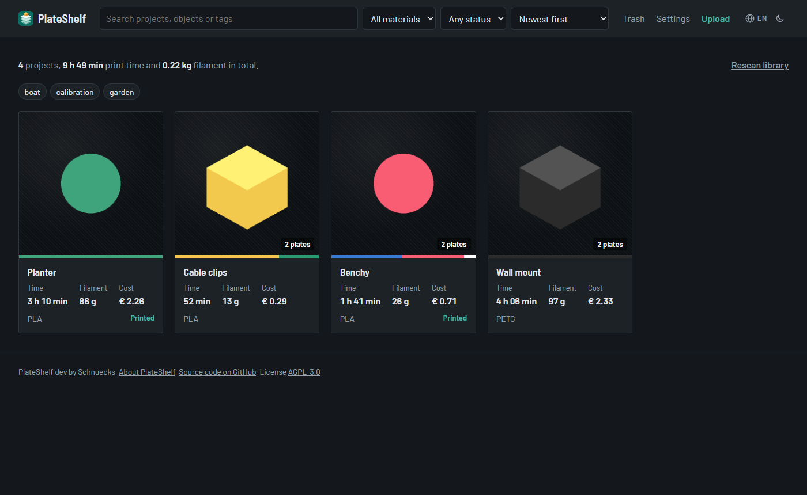
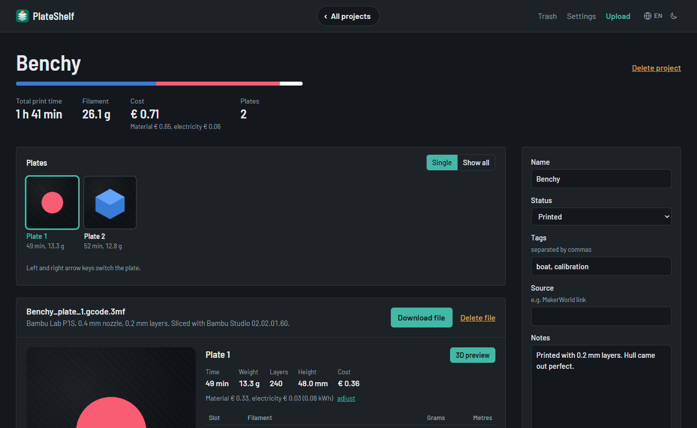
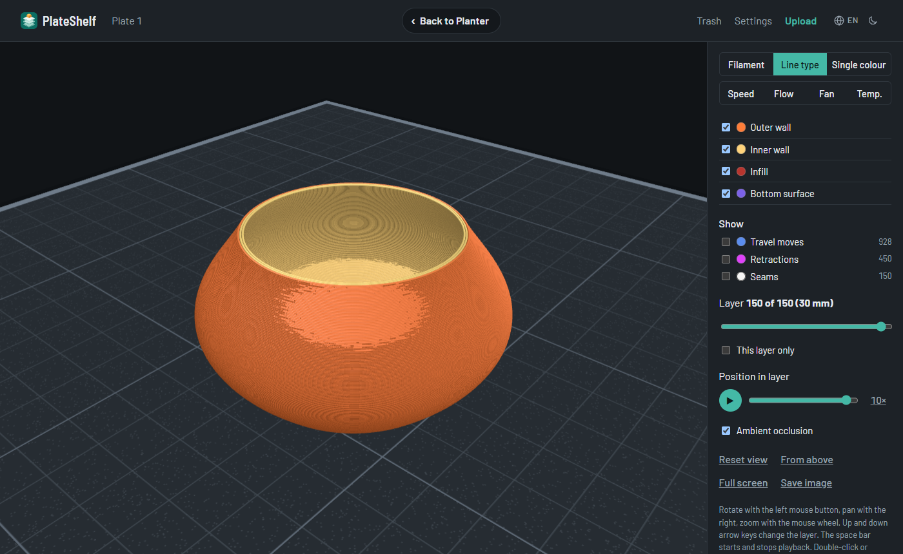

<p align="center"></p>

# PlateShelf

**English** · [Deutsch](README.de.md)

PlateShelf is a self-hosted archive for your 3D prints from Bambu Studio. It reads
sliced `.gcode.3mf` files and presents them as clearly as you know from your slicer:
plates with preview images, print time, weight, filaments with colour and cost, the key
print settings and a 3D preview of the actual toolpaths.



## Contents

- [Features](#features)
- [Screenshots](#screenshots)
- [Installation](#installation)
- [Usage](#usage): library and projects, uploading, direct import from Bambu printers,
  3D preview, costs, trash, language and theme
- [Running PlateShelf](#running-plateshelf): settings, access control, reverse proxy,
  dashboard widget, data and backups
- [Development](#development)
- [License](#license)

## Features

- **Overview** of all projects with search and filters by material, printer, status and tags
- **Project page** with all plates, preview images (angled and top), print time, weight,
  layers, height, filaments per slot and costs
- **MakerWorld details** when included in the file: title, designer, license, print
  profile, description and a photo of the printed model
- **3D preview** of the toolpaths with a layer slider, print playback and colouring by
  filament, line type, speed, volumetric flow, fan or temperature
- **Automatic projects** from folders or file names, with manual reassignment
- **Notes, tags, status and source** per project
- **Upload** by drag & drop and a **trash** with restore
- **Direct import from Bambu printers** via FTPS, even without LAN-only mode
- **Costs** from material and electricity
- **Six languages** (English, Deutsch, Français, Español, Italiano, Nederlands) and a
  **light, dark or system theme**
- **Optional sign-in** and protection against requests from other websites
- **Key figures as JSON**, e.g. for a widget in [Homepage](https://gethomepage.dev)

## Screenshots

| Project | 3D preview |
|---|---|
|  |  |

## Installation

### Requirements

You need Docker with Docker Compose 2.24 or newer. Images are available for PCs and
servers (amd64), 64-bit ARM (arm64, e.g. Raspberry Pi 4/5 with a 64-bit OS and many NAS
devices) and 32-bit ARM (arm/v7, older Raspberry Pi). Docker picks the right one
automatically.

### Quick start

```bash
mkdir plateshelf && cd plateshelf
curl -O https://raw.githubusercontent.com/schnuecks/plateshelf/main/compose.yaml
curl -o .env https://raw.githubusercontent.com/schnuecks/plateshelf/main/.env.example
mkdir -p library data
docker compose up -d
```

PlateShelf is now available at `http://<server>:8000`. Put your `.gcode.3mf` files into
the `library` folder. They show up within two minutes, or immediately via “Rescan
library” in the overview.

The `library` and `data` folders must be writable for the user the container runs as
(`PUID` and `PGID` in the `.env`, default 1000). Otherwise startup fails with “unable
to open database file”.

### Updating

```bash
docker compose pull && docker compose up -d
```

The database is upgraded automatically on startup if needed. If the format of the 3D
preview changes, the previews are rebuilt once in the background. What changed in each
version is listed in the [CHANGELOG](CHANGELOG.md).

### Upgrading from Druckarchiv

PlateShelf was called *Druckarchiv* up to version 0.6. Your data carries over as is:

- In your `.env`, replace `DRUCKARCHIV_IMAGE` with
  `PLATESHELF_IMAGE=ghcr.io/schnuecks/plateshelf:latest`, or download the new
  `compose.yaml` and `.env.example` as in the quick start and copy your values over.
- The database `druckarchiv.sqlite` in the data folder is renamed to
  `plateshelf.sqlite` automatically on first start.
- If your library already has a `Vom Drucker` folder from the direct import, it keeps
  being used. New installations use `From printer`.
- Settings stored in the browser (colour mode, camera position and so on) are kept.

## Usage

### Library and projects

**Sliced files** (`.gcode.3mf`) work best. Create them in Bambu Studio via “Export →
Export plate sliced file” or “Export all sliced file”. Only these files contain print
time, weight and filament usage.

This is how projects are formed:

- **Each subfolder** of the library is a project.
- **Files in the main folder** are grouped by name: `Benchy_plate_1.gcode.3mf` and
  `Benchy_plate_2.gcode.3mf` both end up in the project “Benchy”. Suffixes such as
  `_plate_3`, ` (2)`, `_v2`, `_gcode` or `.stl` are ignored.
- **Meaningless names** such as `(Unsaved)` or random IDs are replaced by the title
  stored in the file, if there is one.
- On the project page, every file can be **assigned to another project by hand**. This
  assignment survives a rescan.

If you export plates individually, each file also contains the preview images of all
other plates. If a plate is available sliced in another file of the project, its
preview is not shown twice.

### Uploading

Use “Upload” in the top right to upload one or more files by drag & drop, optionally
straight into a project folder. Existing files are never overwritten: identical files
are skipped, and files with the same name but different content get “(2)” appended.

### Direct import from Bambu printers

PlateShelf can fetch sliced prints from the SD card of your Bambu printers itself. It
connects via FTPS using the printer’s access code. LAN-only mode is not required as long
as the firmware allows file access.

**Set up in the interface:** Add your printers under “Settings” → “Printers for direct
import”: name, IP address, serial number and access code. You find these in the network
settings on the printer. The access code is stored but never shown again; leave the
field empty when editing to keep it. After saving, the printers are queried right away
and the result is shown next to each printer.

**Set up via `.env`:** Alternatively, define the printers numbered from 1:

```bash
PRINTER_1_NAME=P2S
PRINTER_1_IP=192.0.2.20
PRINTER_1_SERIAL=<serial number>
PRINTER_1_CODE=<access code>
PRINTER_2_NAME=A1 mini
# …
```

Printers set up this way appear read-only in the settings. If a serial number is set in
both places, the `.env` wins.

**How it works:**

- Every `PRINTER_SYNC_INTERVAL` seconds (default 600), or immediately via “Fetch from
  printers” in the overview, PlateShelf lists the files on the SD card.
- New prints are stored under `From printer/<printer name>/` in the library and grouped
  into projects by name.
- The printer always saves a project under the same name and overwrites it when a
  different plate is printed. PlateShelf therefore stores each printed plate as a file
  of its own (`…_plate_2.gcode.3mf`), so nothing gets lost.
- Each file is fetched only once. What you delete in the archive is not imported again.
- Files on the printer are only read, never changed or deleted.
- If a printer is switched off or in standby, it is simply queried again next time. Only
  a wrong access code shows up as a warning in the overview.

### 3D preview

A `.gcode.3mf` no longer contains a 3D model but the finished G-code. The 3D preview
therefore shows the actual toolpaths, similar to Bambu Studio.

**Colouring**

- by filament, by line type (outer wall, infill, supports and so on) or in a single
  colour of your choice, handy for light filaments
- by measurement, like in the slicer: speed (mm/s), volumetric flow (mm³/s), part
  cooling fan (%) and nozzle temperature (°C), on a scale from blue (low) to red (high).
  Single outliers don’t distort the scale.
- Individual filaments and line types can be hidden.
- Travel moves, retractions and seams (start of each outer wall) can be shown, each with
  a count. This helps to explain stringing or an uneven seam.

**Layers and playback**

- Layer slider with height display, also via the up and down arrow keys
- “This layer only” shows a single layer.
- Playback lets the print head trace the toolpaths layer by layer (▶ or space bar,
  speed 1×, 10× or 50×). “Position in layer” moves to any point of a layer by hand.
- The left and right arrow keys switch between the plates of a project.

**View**

- Rotate with the left mouse button, pan with the right, zoom towards the cursor with
  the mouse wheel; on touch devices with one or two fingers
- Double-click or double-tap resets the view; the camera position is remembered per plate.
- Full screen (also key F) and “Save image” as PNG
- The model stands on a build plate with 10 and 50 mm lines. Seen from below, the plate
  is hidden so the first layer stays visible.
- Ambient occlusion darkens the grooves between lines and layers and makes the model look
  more three-dimensional. It is only active while the view is still, switches off
  automatically on slow devices and can be turned off by hand.

**Performance:** After a file is read, its G-code is processed once in the background
and cached in the data folder. For very large prints (100 MB of G-code) this takes about
10 to 20 seconds; after that the preview opens instantly. When opening, the preview
briefly measures the device and, while rotating, automatically picks the best-looking
display that still runs smoothly. No internet connection is required.

### Costs

The costs shown consist of material and electricity:

- **Material:** usage per filament times the price from the filament profile in Bambu
  Studio (“Price” field). If no price is set there, this part is missing.
- **Electricity:** print time times the printer’s average power times the electricity
  price. You set price and power under “Settings”, per printer if you like. Defaults are
  €0.35 per kWh and 100 watts.

The most accurate way to measure average power is a smart plug with energy metering:
energy of one print in Wh divided by the print time in hours. Wear and failed prints are
not included.

### Trash

You delete files or entire projects on the project page. They are not removed right
away but moved, with their original path, into the `.papierkorb/` folder inside the
library. Right after deleting, you can take it back with “Undo”.

“Trash” in the top right lists all deleted files and projects:

- **Restore** puts the files back where they were. Project name, notes, tags, status,
  source and manual assignments come back too. If another file with the same name is
  there by now, the restored one is saved as “(2)”. Nothing is ever overwritten.
- **Delete permanently** removes one item, **Empty trash** removes all of them.
- Items are deleted permanently after `TRASH_DAYS` days (default 30). With
  `TRASH_DAYS=0` they stay until you delete them yourself.

### Language and theme

In the top right of the title bar you choose the language (globe with a code such as
“EN”) and the theme: clicking the icon switches between system, light and dark. Both
apply per browser, so everyone in the household can have their own setting. Numbers,
amounts and dates follow the selected language.

Without a choice, `DEFAULT_LANGUAGE` and `DEFAULT_THEME` from the `.env` apply. If no
language is set there either, the browser language is used, and English if that isn’t
one of the six.

## Running PlateShelf

### Settings

All settings live in the `.env`. The `compose.yaml` passes them to the container.

**Container and folders**

| Variable | Default | Meaning |
|---|---|---|
| `PLATESHELF_IMAGE` | `ghcr.io/schnuecks/plateshelf:latest` | Image to use |
| `PUID`, `PGID` | 1000 | User and group the container runs as |
| `TZ` | Europe/Berlin | Time zone |
| `PORT` | 8000 | Port on the host |
| `LIBRARY` | `./library` | Folder with the `.gcode.3mf` files |
| `DATA` | `./data` | Folder for database, preview images and 3D previews |
| `LOG_LEVEL` | INFO | Log verbosity (`docker compose logs`): `DEBUG`, `INFO` or `WARNING` |

**Library**

| Variable | Default | Meaning |
|---|---|---|
| `SCAN_INTERVAL` | 120 | Seconds between two scans of the library |
| `MAX_UPLOAD_MB` | 1024 | Size limit per uploaded file in MB |
| `PREVIEW_PREBUILD` | true | Prepare 3D previews in the background after reading files |
| `TRASH_DAYS` | 30 | Days until items are deleted permanently from the trash (0 = never) |

**Direct import**

| Variable | Default | Meaning |
|---|---|---|
| `PRINTER_<n>_NAME`, `_IP`, `_SERIAL`, `_CODE` | – | Printers for the direct import (optional) |
| `PRINTER_SYNC_INTERVAL` | 600 | Seconds between two printer queries |
| `PRINTER_IMPORT_DIR` | From printer | Target folder for imported prints in the library |

**Interface**

| Variable | Default | Meaning |
|---|---|---|
| `DEFAULT_LANGUAGE` | – | Default language: `en`, `de`, `fr`, `es`, `it` or `nl`; empty: browser language |
| `DEFAULT_THEME` | system | Default theme: `system`, `light` or `dark` |

**Access control**

| Variable | Default | Meaning |
|---|---|---|
| `AUTH_USER`, `AUTH_PASSWORD` | – | Turn on sign-in (set both) |
| `SESSION_DAYS` | 30 | How long a sign-in lasts in the browser |
| `SECRET_KEY` | – | Key for sign-in sessions; empty: generated once and stored in the data folder |
| `TRUSTED_ORIGINS` | – | Additional addresses allowed to send changes, comma-separated |

### Access control

Out of the box, PlateShelf has no sign-in: anyone who can reach it can upload and
delete files. On a home network that is usually fine. For more protection there are two
options, which can also be combined.

**Built-in sign-in:** set `AUTH_USER` and `AUTH_PASSWORD` in the `.env`.

- The browser then shows a sign-in page. A sign-in lasts `SESSION_DAYS` days, and “Sign
  out” appears in the top right.
- After five failed attempts, an address is blocked for five minutes.
- Changing the password ends all existing sessions.
- Scripts and dashboards sign in with the same credentials via HTTP Basic Auth.
- `/healthz` stays reachable for the Docker health check, but without sign-in it only
  reports that PlateShelf is running.

**Sign-in at the reverse proxy**, e.g. with Authelia or Basic Auth. This is recommended
especially if PlateShelf is reachable from the internet.

**Protection against other websites:** Regardless of the above, PlateShelf only accepts
changes (upload, delete, settings …) from its own pages. Forms that another website
sends to PlateShelf in the background are rejected. What counts is the address the
browser sends along; behind a proxy, the forwarded host (`X-Forwarded-Host`) counts.
Scripts without a browser (e.g. `curl`) are not affected. To allow additional sites to
send changes, add them to `TRUSTED_ORIGINS`, for example
`TRUSTED_ORIGINS=https://dashboard.example.com`.

### Behind a reverse proxy

PlateShelf listens on port 8000 inside the container and needs no special proxy
settings. An example for Traefik (instead of `ports:` in the `compose.yaml`):

```yaml
    labels:
      - traefik.enable=true
      - traefik.http.routers.plateshelf.rule=Host(`plateshelf.example.com`)
      - traefik.http.services.plateshelf.loadbalancer.server.port=8000
```

### Widget for Homepage and other dashboards

At `/api/stats`, PlateShelf provides its key figures as JSON:

| Field | Meaning |
|---|---|
| `projects`, `files`, `plates` | Number of projects, files and sliced plates |
| `print_time_h`, `print_time_s` | Print time of all projects in hours or seconds |
| `filament_kg`, `filament_g` | Filament usage |
| `cost_eur`, `energy_kwh` | Costs (material and electricity) and energy use |
| `new_files_7d`, `last_added` | New files in the last 7 days, time of the newest |
| `printers_ok`, `printers_total`, `last_printer_sync` | Reachable and configured printers, last query |
| `trash_items`, `version` | Items in the trash, PlateShelf version |

For [Homepage](https://gethomepage.dev), the built-in `customapi` widget in your
`services.yaml` is all you need. A tile shows up to four fields:

```yaml
- PlateShelf:
    icon: mdi-printer-3d
    href: http://<server>:8000
    description: 3D prints
    widget:
      type: customapi
      url: http://<server>:8000/api/stats
      refreshInterval: 60000
      mappings:
        - field: projects
          label: Projects
          format: number
        - field: print_time_h
          label: Print time
          format: float
          suffix: h
        - field: filament_kg
          label: Filament
          format: float
          suffix: kg
        - field: cost_eur
          label: Cost
          format: float
          suffix: €
```

- Instead of the costs, `new_files_7d` (“New (7 days)”) or `printers_ok` (“Printers
  online”) work well too.
- If the built-in sign-in is on, also add `username` and `password` to the widget, with
  the same values as `AUTH_USER` and `AUTH_PASSWORD`.
- If Homepage and PlateShelf share a Docker network, use the internal address for
  `url`, e.g. `http://plateshelf:8000/api/stats`. This also works if PlateShelf sits
  behind a sign-in at the proxy from the outside.

### Data and backups

- Files in the library are never modified, only moved to the trash when you delete them.
- The database (SQLite), preview images, 3D previews and your notes are stored in the
  data folder. Backing up this folder is enough; the 3D previews in it are rebuilt when
  needed.
- New and changed files are detected regularly, also on network shares (SMB/NFS). Keep
  the data folder on a local disk, though, because SQLite is unreliable on network
  shares.

## Development

### Running and testing locally

```bash
python -m venv .venv && . .venv/bin/activate
pip install -r requirements-dev.txt
python -m pytest -q                        # run the tests
python tools/make_sample.py ./library      # create sample files
LIBRARY_DIR=./library DATA_DIR=./data uvicorn app.main:app --reload
```

There is also a browser test that opens all pages and the 3D preview in Chromium and
fails on any JavaScript error:

```bash
pip install -r requirements-browser.txt
python -m playwright install chromium
python -m pytest -q tests/test_browser.py
```

`python tools/make_screenshots.py` recreates the screenshots in this README.

### Translations

The German texts in the code double as keys for the translations in
`app/locales/<language>.json`. After changing or adding texts,

```bash
python tools/i18n_extract.py
```

shows per language what is missing or no longer used. The tests fail as long as a
translation is missing or its placeholders (`{n}`, `{name}` …) don’t match the German
text. A new language needs an entry in `LANGUAGES`, `NUMBER_FORMAT`, `MONTHS` and
`DAY_MONTH` in `app/i18n.py` plus its own JSON file.

### Tests, builds and releases

- Every pull request and every push to `main` runs the Python tests and the browser
  test and builds the image for amd64, arm64 and arm/v7 as a trial. Nothing is
  published.
- A release is created by a version tag:

  1. Add the changes to `CHANGELOG.md` under the new version number.
  2. Create and push the tag:

     ```bash
     git tag -a v1.2.3 -m "PlateShelf 1.2.3" && git push --tags
     ```

  3. GitHub Actions tests, builds the image for all platforms and publishes it as
     `1.2.3`, `1.2` and `latest`. Older versions are then removed; the last five releases
     are kept.

- Dependabot (`.github/dependabot.yml`) checks Python packages, GitHub Actions and the
  base image weekly and proposes updates as pull requests. Known vulnerabilities are
  reported immediately and fixed automatically via pull request. Such updates reach the
  published image with the next release.

## License

Copyright (C) 2026 Schnuecks

PlateShelf is free software under the
[GNU Affero General Public License, version 3 or later](LICENSE) (AGPL-3.0-or-later). You
may use, modify and share it.

If you distribute a modified version or offer it to others over a network, you must make
the source code of your version available to them under the same license. The “Source
code on GitHub” link in the footer does that for this version; for your own version,
point it to your source code (`APP_REPO` in `app/main.py`).

The program is provided without any warranty. See the [license](LICENSE) for details.

### Third-party components

`app/static/vendor/` contains [three.js](https://threejs.org) and OrbitControls, both
under the MIT license (see `three-LICENSE`). The MIT license is compatible with the AGPL.
