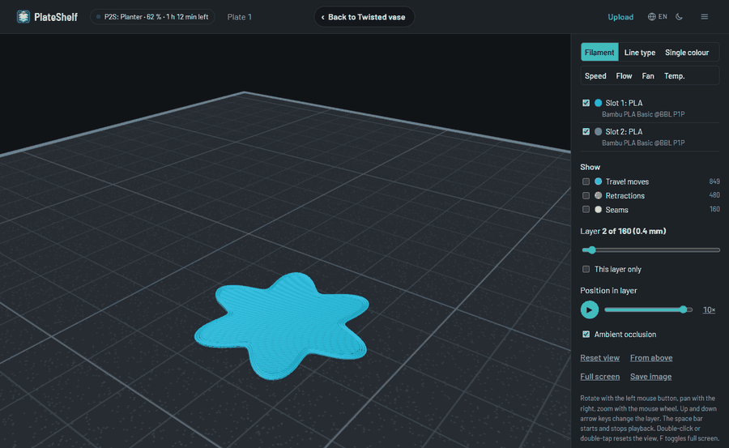
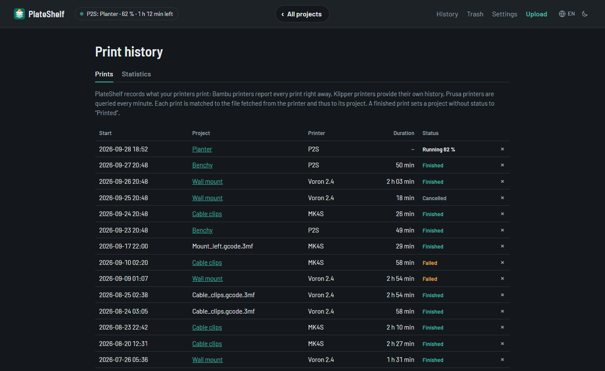
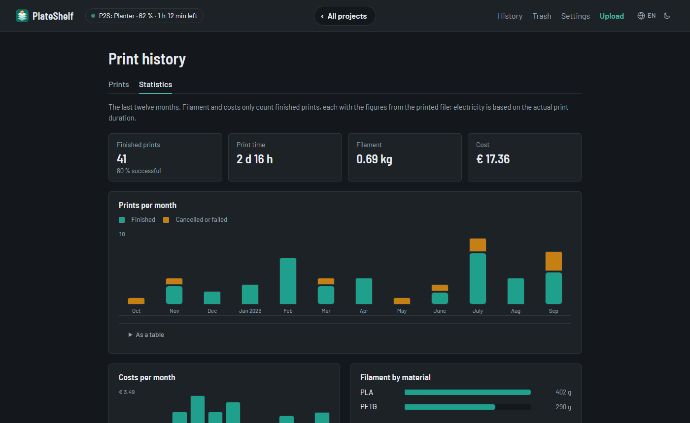

<p align="center"></p>

# PlateShelf

**English** · [Deutsch](README.de.md)

<p align="center">
  
  <a href="https://github.com/Schnuecks/plateshelf/pkgs/container/plateshelf"></a>
  
  <a href="https://github.com/Schnuecks/plateshelf/actions/workflows/ci.yml"></a>
  <a href="https://github.com/Schnuecks/plateshelf/actions/workflows/zap.yml"></a>
  <a href="LICENSE"></a>
  
</p>

PlateShelf is a self-hosted archive for your 3D prints. It reads sliced `.gcode.3mf`
files from Bambu Studio and OrcaSlicer, `.gcode` files from PrusaSlicer, OrcaSlicer, Cura
and similar slicers and binary `.bgcode` files from PrusaSlicer, and presents them as clearly as you know from your slicer:
plates with preview images, print time, weight, filaments with colour and cost, the key
print settings and a 3D preview of the actual toolpaths.


## Features

- **Overview** of all projects with search and filters by material, printer, status and tags
- **Project page** with all plates, preview images, print time, weight, filaments and costs,
  plus MakerWorld details when included in the file
- **3D preview** of the toolpaths with a layer slider, print playback and colouring by
  filament, line type, speed, volumetric flow, fan or temperature
- **Automatic projects** from folders or file names, notes, tags and status per project,
  your own **photos of the print** as cover
- **Upload** by drag & drop, a **trash** with restore, editing several projects at once
  and projects as ZIP
- **Daily automatic backups**, restore in the interface
- **Direct import from printers:** Bambu Lab, Prusa via PrusaLink, Klipper printers via
  Moonraker (e.g. Creality K1/K2, Sovol SV08, Qidi, Voron) and OctoPrint
- **Print history and statistics:** what was printed when, on which printer, and whether it
  finished, with a note and rating per print
- **Print again (optional, Bambu Lab):** send a sliced plate back to the printer and start it,
  with the filaments mapped to the AMS slots
- **User accounts** with roles (admin, user, read only), device list and read-only API tokens;
  single sign-on with Authelia, Authentik, Keycloak & co. (OIDC)
- **Six languages** and **five styles** (Classic, Candy, Workbench, Blueprint, Pinboard), each
  light and dark, installable on the home screen, key figures as JSON for dashboards



| Project | 3D preview |
|---|---|
|  |  |

| Print history | Statistics |
|---|---|
|  |  |

## Quick start

You need Docker with Docker Compose 2.24 or newer (amd64 or arm64, e.g. Raspberry Pi 4/5).

```bash
mkdir plateshelf && cd plateshelf
curl -O https://raw.githubusercontent.com/schnuecks/plateshelf/main/compose.yaml
curl -o .env https://raw.githubusercontent.com/schnuecks/plateshelf/main/.env.example
mkdir -p library data
docker compose up -d
```

Open `http://<server>:8000` and create the admin account; the setup code is in the log
(`docker compose logs plateshelf`). Then put your print files into the `library` folder. To update:
`docker compose pull && docker compose up -d`.

## Printing from PlateShelf (optional)

Off by default. To print a sliced plate straight from its project page on a Bambu Lab printer:

1. Set up the printer for the direct import and keep the print history switched on.
2. On the printer, switch on **LAN-only mode** and then **developer mode** (Settings → Network).
   Newer Bambu firmware refuses start commands from other programs otherwise. In this mode the
   printer is **not connected to the Bambu cloud**: no Bambu Handy remote access, no cloud prints.
3. In PlateShelf, switch on **Settings → Print history → Allow printing from PlateShelf** (or set
   `PRINT_SEND=true` in `.env`).

Plates then show **Print**. Details in [Printers](docs/en/printers.md#print-again-bambu-lab).

## Documentation

- [Installation](docs/en/installation.md): updating, reverse proxy, data and backups
- [Configuration](docs/en/configuration.md): all settings, user accounts and secrets
- [Usage](docs/en/usage.md): library, projects, 3D preview, costs, trash
- [Printers and print history](docs/en/printers.md): direct import, history, statistics
- [Dashboard widget](docs/en/dashboard.md): key figures for Homepage and others
- [Development](docs/en/development.md): running locally, tests, translations

What changed in each version is listed in the [CHANGELOG](CHANGELOG.md).

## Security

PlateShelf reads files from the internet and talks to your printers, so it is built to be
careful with both:

- **Files:** size limits for every part of a `.3mf`, `.gcode` or `.bgcode` file (no zip bombs),
  safe file names, photos re-encoded without metadata.
- **Printers:** the import only lists and downloads files – PlateShelf never starts a print or
  sends commands to a printer. With `SECRET_KEY` set, printer credentials are stored encrypted.
- **Sign-in:** per-address and per-user limits on failed sign-ins, passkeys, single sign-on that
  never takes over an existing account by its name, a strict Content Security Policy without
  inline code, and a container without root.
- **Checked on every change:** Python and browser tests, Trivy scan of the image, OWASP ZAP
  baseline scan, Dependabot.
- **Reviewed:** before the public release, a security review (assisted by AI); the findings were
  fixed, the main ones reproduced with tests first – see versions 0.17 and 0.18 in the
  [changelog](CHANGELOG.md).

Please report vulnerabilities privately, see [SECURITY.md](SECURITY.md).

## How it's built

PlateShelf is developed with the help of an AI coding assistant. I define the features and
behaviour, review the changes and test them on my own printers and test setups (Bambu Lab,
Prusa, Klipper, OctoPrint). Nothing is released without passing the automated checks: Python
tests, browser tests and a container security scan.

## Support

PlateShelf is free and stays free. If it saves you time, you can buy me a coffee; it keeps
the project going. Thank you!

<p>
  <a href="https://ko-fi.com/schnuecks"></a>
</p>

## Feedback

Bug reports and ideas are welcome as [GitHub issues](https://github.com/schnuecks/plateshelf/issues).
For bugs, please paste the text from “Settings” → “Diagnostics” → “Copy”; it contains no
credentials, addresses or printer names. See also [CONTRIBUTING](CONTRIBUTING.md) and
[SECURITY](SECURITY.md).

## License

Copyright (C) 2026 Schnuecks

PlateShelf is free software under the
[GNU Affero General Public License, version 3 or later](LICENSE) (AGPL-3.0-or-later). You
may use, modify and share it.

If you distribute a modified version or offer it to others over a network, you must make
the source code of your version available to them under the same license. The “Source
code on GitHub” link in the footer does that for this version; for your own version,
point it to your source code (`APP_REPO` in `app/web.py`).

The program is provided without any warranty. See the [license](LICENSE) for details.
`app/static/vendor/` contains [three.js](https://threejs.org) and OrbitControls, both under
the MIT license (see `three-LICENSE`), which is compatible with the AGPL. The Barlow fonts in
`app/static/fonts/` are under the SIL Open Font License (see `OFL.txt` there); PlateShelf serves
them itself, so no page loads anything from Google or other servers.
