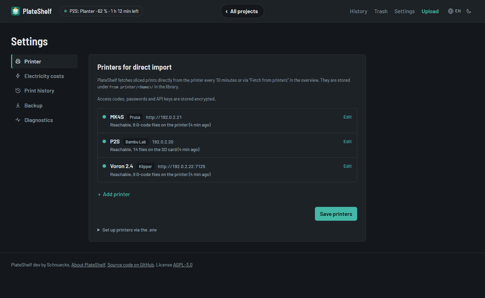

# Drucker und Druckverlauf

[English](../en/printers.md) · **Deutsch** · [← Dokumentation](README.md)



## Direktimport von Druckern

PlateShelf kann geslicte Drucke selbst von deinen Druckern holen:

- **Bambu Lab** per FTPS von der SD-Karte, mit dem Zugangscode des Druckers. Der
  LAN-only-Modus ist dafür nicht nötig, sofern die Firmware den Dateizugriff erlaubt.
- **Prusa-Drucker** über PrusaLink (MK4, MK3.9, XL, Mini, Core One). PlateShelf holt
  die `.bgcode`- und `.gcode`-Dateien vom USB-Stick oder internen Speicher.
- **Klipper-Drucker** über [Moonraker](https://moonraker.readthedocs.io), die
  Schnittstelle hinter Mainsail und Fluidd. Dazu gehören etwa Creality K1 und K2,
  Sovol SV08, Qidi, Elegoo Neptune 4 und Voron. PlateShelf holt die `.gcode`-Dateien
  aus dem G-Code-Ordner des Druckers.

**Einrichten in der Oberfläche:** Trage deine Drucker unter „Einstellungen“ →
„Drucker für den Direktimport“ ein und wähle den Typ. Statt der IP-Adresse geht auch ein
Hostname wie `drucker.local` oder `mini.fritz.box`, sofern PlateShelf ihn auflösen kann
(im Docker-Container nicht immer bei `.local`-Namen).

- *Bambu Lab:* Name, IP-Adresse oder Hostname, Seriennummer und Zugangscode. Die Angaben findest du
  am Drucker in den Netzwerkeinstellungen.
- *Prusa (PrusaLink):* Name, IP-Adresse oder Hostname und das PrusaLink-Passwort. Du findest es am
  Drucker unter Einstellungen → Netzwerk → PrusaLink, der Benutzername ist `maker`.
  Ältere Firmware nutzt stattdessen einen API-Schlüssel: Trag ihn als Passwort ein.
- *Klipper (Moonraker):* Name und Adresse des Druckers. Ohne Portangabe nutzt
  PlateShelf den Moonraker-Standardport 7125; du kannst auch eine vollständige Adresse
  wie `http://192.0.2.21:7125` eintragen. Einen API-Schlüssel brauchst du nur, wenn
  Moonraker den PlateShelf-Rechner nicht unter `trusted_clients` führt. Den Schlüssel
  findest du in Mainsail oder Fluidd oder von einem vertrauenswürdigen Gerät aus unter
  `http://<drucker>:7125/access/api_key`.

Der Punkt vor jedem Drucker in den Einstellungen zeigt alle paar Sekunden, ob er
erreichbar ist. Kommt ein Drucker wieder, holt PlateShelf seine Dateien sofort.


Zugangscodes und API-Schlüssel werden gespeichert, aber nie wieder angezeigt; lässt du
das Feld beim Ändern leer, bleiben sie erhalten. Nach dem Speichern werden die Drucker
sofort abgefragt, das Ergebnis steht bei jedem Drucker.

**Einrichten über die `.env`:** Alternativ gibst du die Drucker durchnummeriert ab 1 vor:

```bash
PRINTER_1_NAME=P2S
PRINTER_1_IP=192.0.2.20
PRINTER_1_SERIAL=<Seriennummer>
PRINTER_1_CODE=<Zugangscode>
PRINTER_2_TYPE=moonraker
PRINTER_2_NAME=K1
PRINTER_2_IP=192.0.2.21
PRINTER_2_API_KEY=<optional>
PRINTER_3_TYPE=prusalink
PRINTER_3_NAME=MK4S
PRINTER_3_IP=192.0.2.22
PRINTER_3_PASSWORD=<PrusaLink-Passwort>
# …
```

`PRINTER_<n>_TYPE` ist `bambu` (Standard), `prusalink` oder `moonraker`. So eingerichtete Drucker
erscheinen in den Einstellungen schreibgeschützt. Ist ein Drucker an beiden Stellen
eingetragen, hat die `.env` Vorrang.

**Ablauf:**

- Alle `PRINTER_SYNC_INTERVAL` Sekunden (Standard 600) oder sofort über „Von Druckern
  holen“ in der Übersicht fragt PlateShelf die Dateien auf dem Drucker ab.
- Neue Drucke landen unter `From printer/<Druckername>/` in der Bibliothek und werden
  über ihren Namen zu Projekten zusammengefasst.
- Der Drucker speichert ein Projekt immer unter demselben Namen und überschreibt es,
  wenn eine andere Platte gedruckt wird. PlateShelf legt deshalb jede gedruckte
  Platte als eigene Datei ab (`…_plate_2.gcode.3mf`), so geht nichts verloren.
  Bei Prusa- und Klipper-Druckern bleibt der Dateiname erhalten; eine geänderte Datei
  ersetzt die bisherige Kopie.
- Jede Datei wird nur einmal geholt. Was du im Archiv löschst, wird nicht erneut
  importiert.
- Die Dateien auf dem Drucker werden nur gelesen, nie verändert oder gelöscht.
- Ist ein Drucker ausgeschaltet oder im Standby, wird er beim nächsten Durchlauf erneut
  abgefragt. Nur ein falscher Zugangscode, ein falsches Passwort oder ein falscher
  API-Schlüssel erscheint in der Übersicht als Warnung.

## Druckverlauf

Für die Drucker aus dem Direktimport schreibt PlateShelf jeden Druck mit: Start, Ende,
Dauer, Drucker und Ausgang (fertig, abgebrochen, fehlgeschlagen). „Verlauf“ in der
Titelleiste zeigt alle Drucke, die Projektseite die Drucke ihrer Dateien, die Übersicht,
wie oft ein Projekt gedruckt wurde. Die Übersicht lässt sich nach „Zuletzt gedruckt“ oder
„Am häufigsten gedruckt“ sortieren und nach „Schon gedruckt“, „Noch nie gedruckt“ oder
„Teilweise gedruckt“ filtern.

**Gedruckte Platten:** Bei Projekten mit mehreren Platten zeigt die Übersicht, wie viele davon
gedruckt sind („3/4 Platten gedruckt“), und die Projektseite markiert jede gedruckte Platte mit
einem Haken und „Gedruckt (2×)“. Ist jede Platte eine eigene Datei, wie bei vom Bambu-Drucker
geholten Platten oder G-Code-Dateien, zählt jeder Druck dieser Datei; enthält eine Datei
mehrere Platten, zählt die Platte, die der Drucker gemeldet hat. „Teilweise gedruckt“ zeigt die
Projekte, bei denen noch Platten fehlen.

Ein laufender Druck erscheint in der Titelleiste mit Drucker, Projekt, Fortschritt und
Restzeit sowie auf der Karte des Projekts in der Übersicht; die Titelleiste frischt sich
alle 30 Sekunden auf. Bambu und Prusa melden die Restzeit selbst, bei Klipper wird sie aus
dem bisherigen Fortschritt geschätzt.

- **Bambu Lab:** PlateShelf hält eine MQTT-Verbindung zum Drucker (Port 8883, derselbe
  Zugangscode) und erfährt so sofort von jedem Druck.
- **Klipper:** Moonraker führt selbst einen Verlauf, den PlateShelf jede Minute abruft.
- **Prusa:** PrusaLink kennt nur den aktuellen Druck; PlateShelf fragt ihn jede Minute ab
  und schreibt ihn mit.

Ein Druck wird der vom Drucker geholten Datei zugeordnet und damit ihrem Projekt. Liegt
die Datei noch nicht in der Bibliothek, holt PlateShelf sie sofort und ordnet den Druck
danach zu. Ein fertiger Druck setzt ein Projekt ohne Status auf „Gedruckt“.

**Notizen pro Druck:** Unter „Notiz“ im Verlauf und auf der Projektseite bewertest du einen
Druck (👍 gelungen, 👎 misslungen) und hältst fest, was gut oder schief lief, etwa „Warping
an einer Ecke, nächstes Mal mit Brim“. Die Projektnotizen beschreiben das Modell, diese
Notizen einen einzelnen Druck.

Testdrucke und Ähnliches entfernst du mit „ד aus dem Verlauf, auf der Verlaufsseite
oder der Projektseite. Sie zählen dann nicht mehr mit; hatte so ein Druck das Projekt
auf „Gedruckt“ gesetzt und bleibt kein anderer fertiger Druck übrig, wird der Status
zurückgesetzt.

Abschalten lässt sich der Verlauf unter „Einstellungen“ → „Druckverlauf“, etwa wenn ein
Bambu-Drucker keine zusätzliche MQTT-Verbindung bekommen soll. `PRINT_HISTORY=true` oder
`false` in der `.env` legt die Einstellung fest; der Schalter in der Oberfläche
entfällt dann.

**Statistik:** Der Reiter „Statistik“ auf der Verlaufsseite zeigt die letzten zwölf
Monate: fertige Drucke, Druckzeit, Filament und Kosten, Drucke pro Monat (fertig sowie
abgebrochen oder fehlgeschlagen), Kosten pro Monat, Filament nach Material und die
Erfolgsquote je Drucker. Filament und Kosten zählen nur fertige Drucke.
